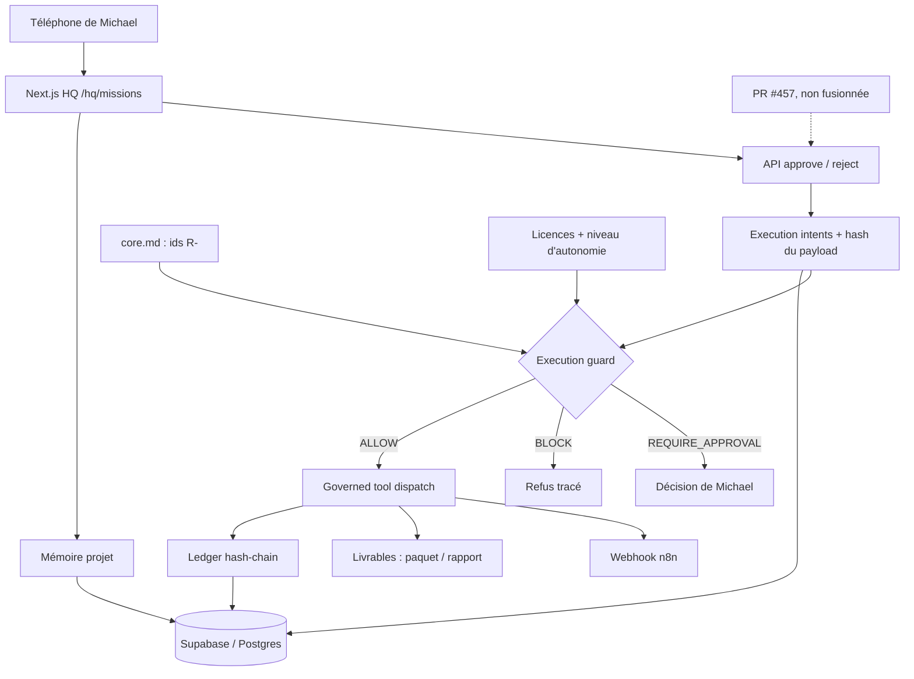

# ORIA HQ — poste de commandement

Oria transforme des objectifs en résultats vérifiables avec une équipe d'agents IA ; Michael décide, les agents préparent et exécutent ce qui est autorisé.

[](https://github.com/mboyer1269-pixel/Oria.HQ.Michael.HQ-APP/actions/workflows/ci.yml?query=branch%3Amain)

> **Maturité.** Le socle de gouvernance est testé en CI, mais le parcours v1 complet n'est pas prouvé. Une CI verte prouve que les tests passent, pas que le comportement en production est correct. Ce README sépare ce qui est prouvé, construit, en cours et absent.

## État réel

Légende : ✅ prouvé (test en CI) · 🟡 construit, non prouvé · 🚧 en cours (branche non fusionnée) · ⬜ absent.
Run CI de référence : [https://github.com/mboyer1269-pixel/Oria.HQ.Michael.HQ-APP/actions/runs/40703151446](https://github.com/mboyer1269-pixel/Oria.HQ.Michael.HQ-APP/actions/runs/40703151446) (vert, main `8aec6ea`).

| Zone | État | Preuve | Code | Vérification |
| --- | --- | --- | --- | --- |
| Garde d'exécution G1 (ids R- de core.md) | ✅ | [`governed-refusal.test.mjs`](src/server/runtime/governed-refusal.test.mjs), [`execution-guard.test.mjs`](src/server/runtime/execution-guard.test.mjs), [run](https://github.com/mboyer1269-pixel/Oria.HQ.Michael.HQ-APP/actions/runs/40703151446) | `src/server/runtime/execution-guard.ts:615-624` (table des règles), `guardGovernedAction` l.665-691 | dernière vérification : `8aec6ea` 2026-10-28 |
| Dispatch gouverné des outils (3 outils) | ✅ | [`governed-tool-dispatch.test.mjs`](src/server/runtime/governed-tool-dispatch.test.mjs), [run](https://github.com/mboyer1269-pixel/Oria.HQ.Michael.HQ-APP/actions/runs/40703151446) | `src/server/runtime/governed-tool-dispatch.ts` | dernière vérification : `8aec6ea` 2026-10-28 |
| Licences d'agents / niveau d'autonomie | ✅ | [`autonomy-tier.test.mjs`](src/server/agents/autonomy-tier.test.mjs), [`execution-guard-autonomy-matrix.test.mjs`](src/server/runtime/execution-guard-autonomy-matrix.test.mjs), [run](https://github.com/mboyer1269-pixel/Oria.HQ.Michael.HQ-APP/actions/runs/40703151446) | `src/server/agents/agent-execution-license.ts`, `autonomy-tier.ts` | dernière vérification : `8aec6ea` 2026-10-28 |
| Approbation liée au hash du payload (G2 partiel, #441) | ✅ | [`execution-intent-approval-binding.test.mjs`](src/server/agents/execution-intent-approval-binding.test.mjs), [run](https://github.com/mboyer1269-pixel/Oria.HQ.Michael.HQ-APP/actions/runs/40703151446) | `src/server/agents/execution-intent-payload-hash.ts` | dernière vérification : `8aec6ea` 2026-10-28 |
| Ledger hash-chain, append-only (chaînes de test uniquement ; non prouvé en production) | ✅ | [`hash-chain-audit.test.mjs`](src/server/ledger/hash-chain-audit.test.mjs), `npm run ledger:audit`, [run](https://github.com/mboyer1269-pixel/Oria.HQ.Michael.HQ-APP/actions/runs/40703151446) | `src/server/ledger/` | dernière vérification : `8aec6ea` 2026-10-28 |
| Mémoire projet scopée au workspace | ✅ | [`memory-file-vault-scope.test.mjs`](src/server/memory/memory-file-vault-scope.test.mjs), [run](https://github.com/mboyer1269-pixel/Oria.HQ.Michael.HQ-APP/actions/runs/40703151446) | `src/server/memory/` | dernière vérification : `8aec6ea` 2026-10-28 |
| Migrations Postgres 0001–0032 | 🟡 | Checks draft / not-live en CI ; application en production non prouvée ici | `db/migrations/` | dernière vérification : `8aec6ea` 2026-10-28 |
| Webhook n8n réel | 🟡 | Outil enregistré ; `smoke:n8n-slice` hors CI | `src/server/agents/tools/n8n-webhook-trigger.ts` | dernière vérification : `8aec6ea` 2026-10-28 |
| Mission room | 🟡 | Compile (build CI) ; aucun test e2e navigateur ou mobile | `src/app/hq/missions/page.tsx` | dernière vérification : `8aec6ea` 2026-10-28 |
| Décisions à usage unique, migration 0033, route d'approbation durcie | 🚧 | [PR #457](https://github.com/mboyer1269-pixel/Oria.HQ.Michael.HQ-APP/pull/457) non fusionnée, checks en échec au 2026-10-28 | branche `feat/g1-attempt-id` | dernière vérification : `8aec6ea` 2026-10-28 |
| Inbox de décisions | ⬜ | Aucun composant dédié trouvé | — | dernière vérification : `8aec6ea` 2026-10-28 |
| Mémoire corrigeable par Michael | ⬜ | Aucun flux de correction prouvé | — | dernière vérification : `8aec6ea` 2026-10-28 |
| Mission téléphone → livrable contrôlé | ⬜ | Aucun test e2e navigateur ou mobile ; `src/scripts/smoke/michael-hq-e2e.mjs` est un e2e Node local, non lancé en CI | — | dernière vérification : `8aec6ea` 2026-10-28 |

## Ce qui reste (écarts v1)

Promesse v1 : « lancer une mission depuis mon téléphone et recevoir un livrable contrôlé », via mission room, inbox de décisions et mémoire projet corrigeable.

- Aucun test e2e navigateur ou mobile téléphone → mission → livrable ; `src/scripts/smoke/michael-hq-e2e.mjs` est un e2e Node local, non lancé en CI.
- L'audit du ledger hash-chain tourne sur des chaînes de test ; rien n'est prouvé en production.
- Inbox de décisions absente ; décisions durcies bloquées sur la PR #457.
- Correction de la mémoire par Michael non construite ou non prouvée.
- Le code définit 14 agents (`src/features/agents/seed.ts`) ; seuls 5 ont une licence (joris, hermes, marketing, inventor, sentinel ; `maxSpendPerActionCents: 0`). Les 9 autres n'ont pas de licence et sont bloqués par défaut.
- Atelier, Sentinelle, Le Mal-Aimé, Architecte Senior et Design sont des assistants Grok Bot qui travaillent sur le dépôt, pas des agents du code. Dans le code, `atelier` est un module, et l'agent `sentinel` est distinct de l'assistant Sentinelle.
- `R-NO-FORCE-PUSH` (`.agents/rules/core.md:52`) et `R-NO-AGENT-ESCALATION` (`.agents/rules/core.md:33`) ne sont pas prouvés : seul le scan textuel heuristique `src/scripts/ci/rules-scan.mjs` les repère ; aucune application à l'exécution ni test de comportement.
- Aucune preuve de comportement en production dans ce dépôt.

Reporté après la v1 : facturation SaaS, marketplace publique, simulation FONDRIA.

## Architecture



Graphe complet du code : [docs/graphify/GRAPH_REPORT.md](docs/graphify/GRAPH_REPORT.md), généré par [Graphify](https://github.com/Graphify-Labs/graphify) en mode code seul, sans LLM (`GRAPHIFY_BACKEND=none graphify extract . --code-only` puis `graphify cluster-only .`), depuis le commit `8aec6ea`. Les fichiers `.sql` n'y figurent pas (analyseur SQL non installé).

## Flux central

1. Michael formule une intention dans HQ ; un agent la prépare en mission et en *execution intent*.
2. La garde juge l'action, pas le texte : `merge`, `deploy`, `remote_migration`, `spend`, `pay`, `delete`, `secret_access`, `external_contact`.
3. Sans décision approuvée : `REQUIRE_APPROVAL`. Décision pour une autre action ou un autre hash : `BLOCK`. Action ou agent inconnu : `BLOCK` (`R-RISK-ROUND-UP`).
4. Avec une décision qui correspond exactement, le dispatch gouverné exécute l'outil et l'événement est ajouté au ledger.

## Démarrage rapide

Prérequis : Node.js 22.x (contrainte du dépôt : `>=22 <23`) et npm 10 ou supérieur.

```sh
npm ci
npm run dev
```

Les variables disponibles sont décrites dans `.env.example`. Conserver les vraies
valeurs dans la configuration locale ou le gestionnaire de secrets du déploiement.
Les intégrations externes exigent leur propre configuration. Le mode local de
certaines fonctions n'est pas une preuve de connexion à Supabase ou aux modèles.
## Structure du dépôt

| Chemin | Contenu |
| --- | --- |
| `src/app/` | Routes Next.js : `hq/` (UI) et `api/` |
| `src/server/runtime/` | Garde d'exécution, dispatch gouverné, webhooks |
| `src/server/agents/` | Licences, autonomie, execution intents, outils |
| `src/server/ledger/` | Ledger hash-chain |
| `src/server/memory/` | Mémoire projet |
| `src/features/` | Logique par domaine (missions, agents, cockpit…) |
| `db/migrations/` | Migrations Postgres avec revert et verify |
| `.agents/rules/core.md` | Registre des règles R- versionnées |
| `docs/` | Contrats, décisions, carte système, graphe Graphify |

## Tests et CI

```sh
npm run typecheck
npm run lint
npm test
npm run build
npm run smoke:joris
```

La CI (`.github/workflows/ci.yml`) lance aussi `audit:deps`, `check:layering`, `map:check`, `smoke:runtime`, `smoke:joris:memex-evidence`, les contrôles ledger et mission, ainsi qu'un audit ledger nocturne. Le smoke Joris utilise le parcours local par défaut ; ne pas activer les écritures externes pour une validation du dépôt. Une CI verte n'est pas une preuve de production.

## Pour les agents de code

Lire [AGENTS.md](AGENTS.md), puis [.agents/rules/core.md](.agents/rules/core.md). En résumé : Postgres est la seule autorité d'état ; un test passe rouge en CI avant son correctif ; un commit à la fois ; aucun force-push ; aucun merge sans le oui écrit de Michael ; aucune API payante ; aucun secret ; rôles séparés (implémenteur, propriétaire des tests, vérificateur) ; ne jamais présenter une hypothèse comme un fait.

## Décisions

- [Journal des décisions](docs/DECISION_LOG.md)
- [Chemin gagnant HQ](docs/HQ_WIN_PATH_DECISION.md)
- [Consolidation des dépôts](docs/REPO_CONSOLIDATION.md)
- [SOUL.md](SOUL.md) : posture des agents
- [Ancien README, historique](docs/HQ_README_BASELINE_2026-06-15.md)
