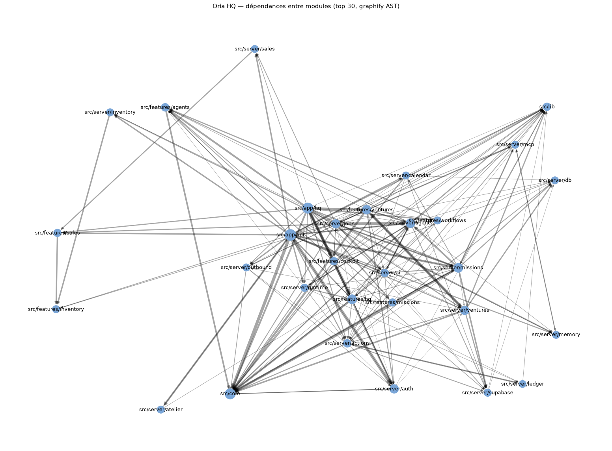
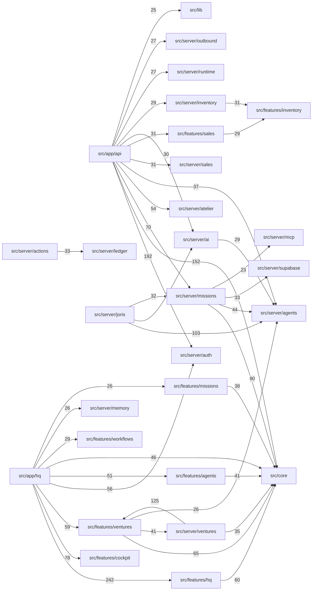

# Graphe d'architecture — Oria HQ

Généré le 2026-10-25 avec [graphify](https://github.com/Graphify-Labs/graphify) 0.9.95 (commit 92741d1, Apache-2.0), **en mode analyse statique seulement** (`GRAPHIFY_BACKEND=none`, `--code-only`, tree-sitter local, 0 token, aucune API). Source : `origin/main` @ a068f09.

- 8 756 nœuds · 19 282 arêtes · 445 communautés · 99 % des arêtes EXTRACTED (lues dans l'AST), 1 % INFERRED
- Cycles d'import détectés : aucun
- Nœuds les plus connectés : `getActiveWorkspaceContext()` (155), `requireOwnerApiSession()` (103), `requireOwnerAccess()` (63), `createOptionalSupabaseAdminClient()` (61), plus les dépendances `jiti`, `next`, `lucide-react`, `zod`, `react`



## Les 40 liens les plus forts entre modules (nombre d'arêtes)



## Régénérer (gratuit, hors ligne)

```bash
uv tool install "graphifyy[sql]==0.9.95"
GRAPHIFY_BACKEND=none graphify extract . --code-only
GRAPHIFY_BACKEND=none graphify cluster-only .
graphify export callflow-html
```

Fichiers produits : `graphify-out/graph.json` (graphe natif), `GRAPH_REPORT.md`, `graph.html` (vue interactive), `*-callflow.html` (Mermaid). Serveur MCP en lecture : `python -m graphify.serve graphify-out/graph.json` (outils `query_graph`, `get_neighbors`, `shortest_path`, `god_nodes`…).
