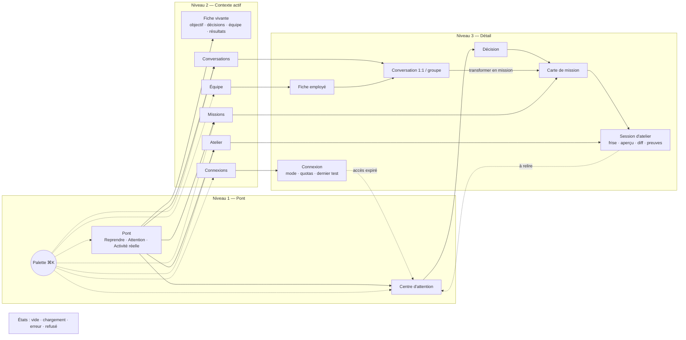

# Architecture d'information — Oria v3 « Pont »

Objectif : un centre d'opérations où **chaque chose a une place fixe**. On ne se perd jamais, parce que (1) les zones de l'écran ne bougent pas, (2) il n'y a que 3 niveaux, (3) le contexte actif est toujours nommé. Fondement : voir `RECHERCHE.md` §4.

## 1. Les 6 zones fixes (desktop 1440)

```
┌──────────────────────────────────────────────────────────────────────────────┐
│ A. BANDE D'ÉTAT 48px : [Contexte ▾] · Titre d'écran · ⌘K · ⚑ Attention 3 · 09 h 07 HAE │
├──────┬────────────────────────────────────────────────────────┬──────────────┤
│ B.   │ C. CONTENU (un seul sujet)                             │ D. DÉTAIL    │
│ RAIL │                                                        │ (tiroir, 1   │
│ 88px │                                                        │ seul niveau) │
│      │                                                        │ 400px        │
│      ├────────────────────────────────────────────────────────┤              │
│      │ E. COMPOSITEUR (conversations seulement)                │              │
└──────┴────────────────────────────────────────────────────────┴──────────────┘
 F. PALETTE ⌘K : couche au-dessus de tout, centrée
```
- **A. Bande d'état** (toujours là) : sélecteur de contexte (pastille de couleur + nom), titre unique de l'écran, déclencheur ⌘K, compteur d'attention (ambre seulement si > 0), heure HAE, indicateur runtime (« Atelier : 1 en cours » animé seulement si un runner tourne réellement).
- **B. Rail** (toujours le même ordre) : 1 Pont · 2 Attention · 3 Conversations · 4 Missions · 5 Équipe · 6 Atelier · 7 Connexions · — · Fiche (contexte) · Réglages. Raccourcis `G` puis la lettre.
- **C. Contenu** : une seule liste ou un seul document.
- **D. Détail** : s'ouvre à droite, jamais empilé ; `Échap` le ferme.
- **E. Compositeur** : en bas, seulement dans Conversations.
- **Mobile 390** : A devient une barre de 56px (contexte + attention), B devient une barre d'onglets en bas (Pont · Attention · Conversations · Missions · Plus) ; D devient une feuille plein écran avec « ← Retour » en haut à gauche.

## 2. Niveaux
| Niveau | Rôle (ISA-101) | Écrans |
|---|---|---|
| N1 | Vue d'ensemble, tous contextes | Pont, Attention |
| N2 | Un contexte | Conversations, Missions, Équipe, Atelier (liste), Connexions, Fiche |
| N3 | Un objet | Conversation, Mission, Fiche employé, Session d'atelier, Connexion, Décision |

## 3. Carte de tous les écrans



Liste exhaustive des maquettes : `pont`, `attention`, `fiche`, `conversations`, `conversation`, `mission`, `missions`, `equipe`, `employe`, `atelier`, `atelier-session`, `connexions`, `connexion`, `palette`, `etats` — en 1440 et 390.

## 4. Parcours

### P1. Parler à un employé
Rail **Équipe** → carte « Léa, analyste » → tiroir fiche (poste, mandat, runtime, modèle, droits séparés) → **Écrire** → Conversation 1:1. L'en-tête de conversation rappelle participant, rôle, modèle *observé*. 3 actions.

### P2. Conversation → mission
Dans la conversation, Oria propose « Cela ressemble à une mission ». Bouton **Transformer en mission** → la carte apparaît *dans le fil* avec résultat attendu, responsable, modèle, outils, budget, permissions — chaque champ modifiable. **Lancer** (2ᵉ action indépendante, NASA F.4.1) → la carte passe « En cours » ; la mission apparaît dans Missions et Atelier.

### P3. Retour du lendemain — « Reprendre »
Ouverture → Pont. Carte **Reprendre** en premier : « Hier 17 h 40 HAE vous étiez dans *Calculatrice de pourboire*, étape *Correction* interrompue (runner_died), reprise possible ». Bouton **Reprendre ici** ouvre la session d'atelier sur l'étape exacte. Ce qui a changé depuis hier est listé (« 2 nouveautés »), rien n'est relancé sans clic : pas d'action dupliquée.

### P4. Décisions en attente
Compteur ⚑ dans la bande d'état → Centre d'attention, onglet *Priorité*. Chaque carte : type (Décision / Précision / Accès expiré / Budget / Exécution incertaine / À relire), contexte, ce qui est bloqué, choix proposés. **Décider** dans le tiroir ; **Reporter** (`H`) avec heure de rappel.

### P5. Atelier
Rail **Atelier** → liste des sessions (statut libellé FR) → session : en haut le résultat attendu et le statut ; à gauche la **frise** des étapes (spec/code/test/aperçu/correction, exécutant codex_cli ou runner, badge « reprise ») ; au centre l'aperçu ou le diff ; à droite les preuves (modèle demandé vs observé, branche, commit, sha256 des artefacts). Actions finales : **Accepter**, **Demander une correction**, **Rejeter**.

### P6. Connexions
Rail **Connexions** → liste des comptes : mode (abonnement / API), capacités, quota, dernier test, employés autorisés, expiration. Une connexion expirée génère une carte d'attention « Accès expiré » qui dit l'action impossible, la cause et le choix (Renouveler / Retirer l'accès / Ignorer).

## 5. Règles de navigation
- Retour = `Échap` (ferme le tiroir) puis le rail. Jamais plus de 3 clics pour n'importe quel objet depuis le Pont.
- Le changement de contexte change **visiblement** conversations, documents, accès et missions (plan R4) : la pastille et le nom changent dans A, le rail affiche le contexte en bas, une bannière de 2 s « Contexte : Dadz Co. » (sans animation si mouvement réduit).
