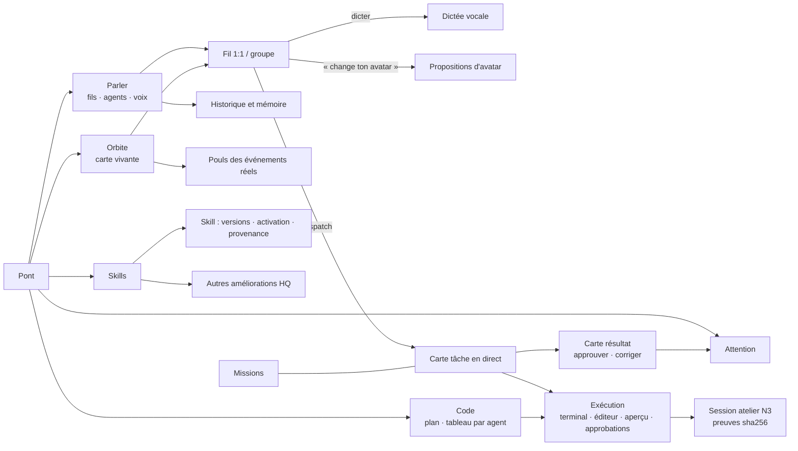

# Intégration des ajouts au Pont v3 — Parler, Code, Skills, Orbite, Avatars

Branche `design/remake-v3-ext` (depuis `design/remake-v3`), créée le 25 octobre 2026 vers 13 h 15 HAE. Préparation uniquement : rien n'est modifié dans `src/`.
Maquettes : `ext/mockups/` (11 écrans et `index.html`, lié depuis `../mockups/index.html`). Captures : `ext/captures/`.

## 0. Ce que contient le dépôt aujourd'hui (exploration de `src/`)
| Domaine | Ce qui existe (chemins) | Manques |
|---|---|---|
| **Chat agent** | `src/app/api/joris/chat/route.ts` : GET (options de modèle) et POST (`message` ≤ 4000 caractères, `modelSelection`). `src/server/joris/brain.ts` (`runJorisCommand`). `detect-intent.ts`, `mission-router.ts`, `joris-reply-generator.ts`. `src/features/cockpit/components/joris-dock.tsx` (UI). `src/features/hq/chat-input-draft.ts` | **Les fils ne sont pas persistés** : `joris-dock.tsx` garde les tours dans un `useState(SEED)`. Une seule voix (Joris), pas de sélecteur d'agent. Pas de pièces jointes dans le chat. Pas de recherche d'historique. **Aucune entrée vocale** : aucune occurrence de SpeechRecognition, getUserMedia ou whisper dans `src/` |
| **Modèle honnête** | `src/server/joris/chat-model-binding.ts` : catalogue qualifié côté serveur (`ORIA_HQ_CHAT_CAPABILITIES_FILE`), états listed/connected/authorized, tarif. `src/server/ai/model-router.ts` (`chooseModel`, `recordBrainRoute`). `hq-model-catalog.ts`, `execution-models.ts`, `call-accounting.ts` | Pas de champ « modèle observé » renvoyé au fil de chat. Quand le catalogue est absent, la route renvoie `status: "unavailable"`, et l'UI doit alors afficher « non confirmé » |
| **Conversation → mission** | `src/server/missions/mission-draft-control.ts`, `mission-draft-confirmation.ts`, `/api/missions/draft/confirm`, `/api/missions/draft/cancel`. `src/features/hq/components/mission-draft-pending-panel.tsx`. `src/features/hq/mission-draft-format.ts` | La carte de brouillon n'est pas rendue **dans** le fil. Pas de lien retour mission → fil |
| **Mémoire** | `/api/memory`, `/api/memory/search`, `/api/memory/proposals`, `/api/memory/review`. `src/features/memory/components/*` (memex, vault explorer) | Pas d'affichage « mémoire utilisée par cette réponse » |
| **Code / atelier / runtime** | `src/app/hq/atelier/page.tsx` (lecture du reçu de mission). `src/server/missions/development-mission.ts`, `/api/missions/development`, `openhands-*` (launch, recovery, tool-permission, tool-inbox, model-execution-receipt), `execution-attempt-store.ts`, `idempotency-contract.ts`. `src/server/runtime/*` (execution-corridors, execution-guard, green-lane). `/api/hq/theatre/stream` (SSE par sondage) | Le contrat `atelier-mission/v1` (`src/server/atelier/atelier-mission.ts`, `docs/atelier-contract.md`) n'existe **que sur `atelier/e1-d`** (PR #412, en conflit). Pas de tableau de tâches par agent. Pas de terminal ni d'éditeur en direct. Pas de statut PR/CI |
| **Approbations** | `/api/agents/execution-intents/[intentId]/approve`, `.../reject`, `/api/missions/approval`. `approval-rail-realtime.tsx` | — |
| **Skills** | `src/app/hq/skills/page.tsx` (lit `skillsCatalog` de `src/features/skills/seed.ts`). `SkillProfile` dans `src/core/types.ts` (entrées/sorties, sideEffects, requiresHumanApproval, logsRequired, testsRequired). `skill-governance.ts`. `src/server/runtime/skill-dispatcher.ts` (`dispatchSkillExecution`). `src/features/agents/components/agent-skill-panel.tsx` | **Catalogue statique (seed)**, pas de table. Pas de version, d'empreinte, d'installation ni d'activation par agent persistée. Pas de compteur d'usage (le grand livre pourrait le fournir) |
| **Agents / profils** | `src/features/agents/seed.ts`, `charter-seed.ts`, `types.ts`. Migrations `db/migrations/0014_agent_score_snapshots`, `0016_agent_outcomes`, `0024_agent_execution_intents` | **Aucune table `agents`** : les profils viennent du seed. **Aucun champ avatar.** `joris-presence.tsx` dit explicitement « Pas d'avatar, pas d'animation décorative ». Il existe des états de présence réels (`joris-presence-state.ts`), réutilisables |
| **Images / stockage** | — | Aucun fournisseur de génération d'image dans `src/server/ai/*`. Aucun appel à Supabase Storage (`storage.from`) dans `src/` |

## 1. Place dans l'architecture du Pont
Rail mis à jour (ordre fixe) : **Pont · Attention · Parler · Missions · Code · Orbite · Skills · Connexions**, puis Fiche et Réglages.
- *Conversations* devient **Parler**, l'espace quotidien.
- *Atelier* devient **Code**, et la session d'atelier reste l'écran N3 de preuve.
- *Équipe* est absorbée par **Orbite**, qui garde une liste équivalente.
- *Skills* est nouveau.

En mobile, la barre d'onglets contient Pont · Parler · Code · Orbite · Plus.

## 2. Le modèle conversationnel : parler, dispatcher, voir exécuter, valider dans le même fil
Ce modèle s'appuie sur les sources du §6.
1. **Parler**, par texte ou micro. La transcription est affichée et modifiable avant l'envoi.
2. **Discuter**. L'agent reformule et annonce ses permissions (« lecture Shopify, aucun envoi externe »).
3. **Dispatcher**. Une carte *Tâche envoyée* apparaît dans le fil, liée à une mission. Elle porte un responsable et un budget.
4. **Exécuter**. Les étapes s'affichent seulement quand un **événement réel** est reçu (SSE `/api/hq/theatre/stream` ou atelier). Aucun pourcentage n'est inventé : une étape en cours dit « événement reçu 13 h 17 ».
5. **Résultat**. Une carte dans le fil liste les artefacts, les liens et les actions Approuver / Demander une correction / Ouvrir la mission. Une approbation alimente Attention.

## 3. Avatars
- **Recherche** (voir §6) : Meta *Muse Realtime Avatar* a été annoncé le 23 septembre 2026. Il anime en temps réel une image de référence (portrait, illustration, animal, objet) à partir du flux vocal de l'agent : 448×768, 25 i/s, environ 870 ms de latence. Selon la presse, on peut déjà personnaliser l'apparence de son Muse. Au 23 octobre, rien n'indiquait de disponibilité générale ni d'API publique. **Ce n'est donc pas une brique utilisable par Oria** ; seule l'idée est reprise : un avatar choisi par description et cohérent partout.
- **Comportement proposé** :
  - avatar visible dans les fils, les en-têtes, les cartes de tâche, le tableau de code et Orbite ;
  - changement depuis le fil par texte ou voix, avec 3 propositions en ligne, choix, puis mise à jour partout ;
  - l'ancienne version est conservée (v1) pour revenir en arrière ;
  - l'agent peut proposer sa propre description.
- **États vivants**, dérivés d'états réels seulement (même logique que `joris-presence-state.ts`) : au repos, écoute (micro actif), réfléchit (requête en cours), exécute (verrou ou étape active), attend (approbation en attente).
  - Un halo « respiration » existe uniquement pour *exécute*. Les autres états n'ont qu'une pastille statique.
  - Avec `prefers-reduced-motion`, tout est statique et l'état reste lu en texte (`aria-label`).
- **Maquettes** : les avatars sont des formes SVG simples badgées « exemple ». Aucune personne réelle n'est représentée.

## 4. Tableau « Bouton → destination → existe ? »
Chaque clic du prototype mène à un écran du prototype (vérifié : 570 liens, 0 lien mort). La colonne de droite indique ce qui existe dans le dépôt.
| Écran | Bouton | Destination prototype | Repo : existe ? / manque backend |
|---|---|---|---|
| Parler | Nouveau fil | chat.html | **À construire** : tables `threads` et `messages`, route `POST /api/threads` |
| Parler | Chercher dans l'historique | chat-recherche.html | **Partiel** : `/api/memory/search` existe. La recherche dans les fils est à construire (dépend des tables de fils) |
| Parler | Choisir un fil / un agent | chat.html | **Partiel** : agents dans `features/agents/seed.ts`. Le chat ne parle qu'à Joris (`/api/joris/chat`) ; ajouter `agentId` |
| Parler | 🎙 Parler (dictée) | chat-voix.html | **À construire** : capture micro (navigateur) et fournisseur de transcription absent du routeur |
| Parler | 📎 Joindre | chat.html | **À construire** : stockage de fichiers (aucun Supabase Storage dans `src/`) |
| Parler | Envoyer | chat.html | **Existe** : `POST /api/joris/chat` |
| Parler | Modèle affiché « non confirmé » | (badge) | **Partiel** : `GET /api/joris/chat` renvoie les options qualifiées. Le modèle *observé* par réponse est à exposer depuis `recordBrainRoute` |
| Parler | Carte tâche → « Voir le détail live » | code-live.html | **Partiel** : SSE `/api/hq/theatre/stream`. Le flux par tâche est à construire |
| Parler | Carte tâche → mission liée | ../mockups/mission.html | **Existe** : `/api/missions/draft/confirm` et `mission-draft-control.ts` |
| Parler | Arrêter | ../mockups/etats.html | **À construire** : annulation d'exécution (pas de route cancel pour les intents ; `/api/missions/draft/cancel` ne couvre que les brouillons) |
| Parler | Résultat → Approuver | ../mockups/attention.html | **Existe** : `/api/agents/execution-intents/[id]/approve`, `/api/missions/approval` |
| Parler | Demander une correction | chat.html | **Partiel** : étape `revision` du contrat atelier (branche e1-d) |
| Parler | Oublier (mémoire) | chat-recherche.html | **Partiel** : `/api/memory/review`. La révocation par note est à vérifier |
| Voix | Envoyer / Annuler | chat-avatar.html / chat.html | voir 🎙 |
| Avatar | Choisir une option | chat-avatar.html | **À construire** : génération d'image (aucun fournisseur), champ `avatar` (aucune table agents) |
| Avatar | Utiliser l'option 1 | orbite.html | **À construire** : `PATCH /api/agents/[id]/avatar`, stockage, versionnage |
| Avatar | Autres propositions / Garder l'actuel | chat-avatar.html / chat.html | idem |
| Code | Voir l'exécution | code-live.html | **Partiel** : `/hq/atelier` lit le reçu ; le direct est à construire |
| Code | Carte de tâche (tableau) | code-live.html | **À construire** : modèle de tâches par agent |
| Code | Demander une tâche (fil de Nova) | chat.html | **Partiel** : `/api/missions/development` |
| Code | Contrat atelier (session réelle) | ../mockups/atelier-session.html | **Branche** `atelier/e1-d` : `atelier-mission.ts` |
| Code live | Accepter | ../mockups/atelier-session.html | **Partiel** : `/api/missions/approval` |
| Code live | Rejeter | ../mockups/etats.html | **Partiel** : `/api/agents/execution-intents/[id]/reject` |
| Code live | Statut PR / CI | (affichage) | **À construire** : lecture GitHub (aucun client GitHub dans `src/server`) |
| Skills | Installer une skill | skill.html | **À construire** : table `skills` et versions (aujourd'hui `features/skills/seed.ts`) |
| Skills | Autres améliorations | ameliorations.html | — |
| Skill | Activer pour un agent | skill.html | **Partiel** : `assignedRoles` dans `SkillProfile` ; la persistance par agent est à construire |
| Skill | Revenir à v1.2.1 | skill.html | **À construire** : versions et empreintes |
| Skill | Usage (30 j) | (affichage) | **Partiel** : événements du grand livre (`server/actions/action-ledger-read.ts`) |
| Orbite | Nœud agent | chat.html / code.html | **Partiel** : états réels via `/api/hq/theatre/stream` |
| Orbite | Pouls des événements | orbite-pouls.html | **Existe (données)** : atelier `mission.json`, theatre |
| Partout | Contexte ▾, ⌘K | ../mockups/palette.html | **Existe** : cmdk ^1.1.1 dans les dépendances |

## 5. Plan incrémental (chaque étape livrable seule)
1. **I1 — Fils persistés** : migration `threads` et `messages` (workspace_id, agent_id, RLS propriétaire) ; `joris-dock` lit et écrit. Montrer le modèle observé ou « non confirmé ».
2. **I2 — Sélecteur d'agent** : `agentId` dans `/api/joris/chat`, entête du fil, recherche d'historique.
3. **I3 — Dispatch dans le fil** : rendre `mission-draft-pending-panel` comme carte de fil, avec un lien vers la mission.
4. **I4 — Exécution visible** : brancher le SSE theatre par tâche ; une carte résultat avec artefacts et approbation.
5. **I5 — Code** : fusionner le contrat atelier (#412) ; tableau par agent ; volets terminal (événements), aperçu, diff ; statut PR via GitHub.
6. **I6 — Skills** : table `skills` et `skill_versions` (sha256, auteur, source), activation par agent, usage depuis le grand livre.
7. **I7 — Table `agents` et avatars** : profil persistant (ID stable), `avatar_url` et version, stockage, puis fournisseur d'image (à choisir ; abonnement plutôt que clé API) ; états vivants dérivés de presence-state.
8. **I8 — Voix** : dictée navigateur, puis fournisseur de transcription qualifié ; voix de sortie facultative.
9. **I9 — Orbite** : vue alternative du Pont, avec la liste équivalente obligatoire.

## 6. Recherche complémentaire (sources ouvertes le 25 octobre 2026)
- **Devin** : <https://docs.devin.ai/work-with-devin/devin-session-tools> (Progress, shell/IDE/navigateur unifiés, chats latéraux) et <https://docs.devin.ai/work-with-devin/interactive-planning>, qui redirige vers la *Tutorial Library*. On y lit qu'on mentionne Devin dans un fil Slack ou Teams, qu'on lance plusieurs sessions le matin et qu'on retrouve des PR brouillon à relire vers midi. → **Dispatcher depuis une conversation, revenir à des résultats à relire.**
- **OpenHands** : <https://docs.openhands.dev/openhands/usage/run-openhands/gui-mode>. Interface web locale (`openhands serve`, Docker), choix du fournisseur et du modèle, serveurs MCP, connexion GitHub/GitLab/Bitbucket, secrets. Le travail se fait « dans une conversation ». Oria a déjà une intégration OpenHands (`src/server/missions/openhands-*`).
- **Codex Cloud (OpenAI)** : <https://developers.openai.com/codex/cloud>. Environnement publié par projet ; chaque tâche a son propre espace de travail et continue « pendant que votre ordinateur dort » ; on inspecte les fichiers modifiés et les résultats, on demande un suivi, puis on committe ou on ouvre une PR. → **Volet diff et tests, puis « Demander une correction » ou PR.**
- **Jules (Google)** : <https://jules.google/docs>. Choix du dépôt et de la branche, puis prompt et « Give me a plan » ; **plan approuvé avant toute modification** ; lit `AGENTS.md` ; notifie quand la tâche est finie ou attend une entrée. → **Plan approuvé dans l'écran Code ; notification via Attention.**
- **Cursor Agents Window** : <https://cursor.com/docs/agent/agents-window> (déjà citée dans RECHERCHE.md).
- **Factory** : non consulté (temps). À faire.
- **Meta Muse** : <https://research.meta.ai/blog/bringing-your-muse-to-life>, <https://www.meta.com/blog/meta-connect-2026-everything-we-announced/>, <https://techcrunch.com/2026/09/23/everything-new-coming-to-metas-ai-agent-muse/> (lus dans les extraits de recherche). Le blogue de recherche précise que ses exemples « illustrent la capacité du modèle » et ne reflètent pas tous ce qui est disponible dans l'app.

**Croisement avec le modèle conversationnel** : toutes ces sources convergent vers *une demande en langage naturel → un plan visible → une exécution isolée → une revue (diff, tests, aperçu) → une PR ou une correction*. La différence d'Oria : tout reste **dans le fil** de l'agent, et l'exécution n'est montrée qu'à partir d'événements réels.

## 7. Direction « Orbite »
Profondeur spatiale sobre : anneaux concentriques, et des agents plus proches du centre quand ils demandent Michael. Halo seulement pour une exécution réelle. Le visuel ambiant (« Pouls ») est tiré des vraies étapes de `mission.json`. Une liste textuelle équivalente est toujours présente sous la carte (clavier, lecteur d'écran). Les contrastes et composants sont ceux du système Pont.

## 8. Vérifications (25 oct. 2026, HAE)

- axe-core (wcag2a/2aa/21a/21aa/22aa, reduced-motion) : **ext 0 violation sur 24 analyses** (12 pages × 1440/390) ; **base 0 violation sur 32 analyses**. Corrigé : `aria-pressed` sur `<a>` (choix d'avatar) → `aria-current`.
- Liens : 570 liens vérifiés, 0 mort, 0 `<a>` sans href.
- Repo inchangé (`src/` non touché) : typecheck=0, lint=0, test=0 (4489 pass / 0 fail), build=0.

## 9. Avatars vivants — états pilotés par événements réels

Page vitrine : `mockups/avatar-etats.html`. Appliqué aux en-têtes de fil (chat, chat-voix), cartes de tâche (code), carte et liste Orbite.

| État | Rendu (transform/opacity seulement) | Événement source | Existe ? |
|---|---|---|---|
| idle | statique, aucun anneau | mission `completed`/`cancelled` + délai, ou aucun flux | existe (`state-machine.ts`) |
| listening | 2 ondes (scale+opacity, 1,6 s) | client `MediaRecorder` start→stop | à construire (aucune voix) |
| thinking | halo qui respire (3,2 s) + 2 particules en orbite (4 s) | `/api/joris/chat` requête envoyée → 1er chunk ; mission `queued` | partiel (chat sans flux d'état) |
| executing | anneau de progression = étapes terminées / total + reflet tournant (1,8 s) | mission `running` ; `ledger.append` via `/api/hq/theatre/stream` (`theatre-events.ts`) | existe |
| waiting (bloqué) | anneau ambre pointillé, halo 4 s | `needs_approval` ; `intent.upsert` (draft-control) | existe |
| done | « settle » 0,6 s **une seule fois**, badge ✓, puis idle | `running → completed` | existe |
| error | anneau rouge statique, secousse unique 0,5 s, badge ! | `failed` ; étape interrompue `runner_died` ; SSE `error` | existe |

Règles : la progression ne bouge qu'à réception d'un événement (aucune interpolation inventée) ; aucun cycle < 1,6 s, donc < 1 flash/s (WCAG 2.3.1) ; `prefers-reduced-motion: reduce` → toutes les animations coupées, anneau et badge statiques ; l'état est toujours dans l'`aria-label` de l'avatar et, dans les en-têtes, dans un texte `role="status" aria-live="polite"`. À construire : un hook client `useAgentState(agentId)` qui réduit theatre SSE + flux chat en ces 7 états.

Captures : `captures/avatar-etats-{1440,390}.png` (mouvement réduit), `captures/avatar-etats-anim-{1440,390}.png` (animé), vidéos `captures/video/avatars-{1440,390}.webm` (avatar-etats → chat → code → orbite). axe : 0 violation sur 26 analyses (13 pages × 2).
